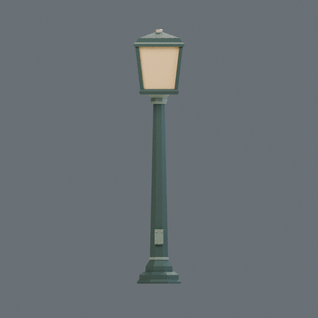
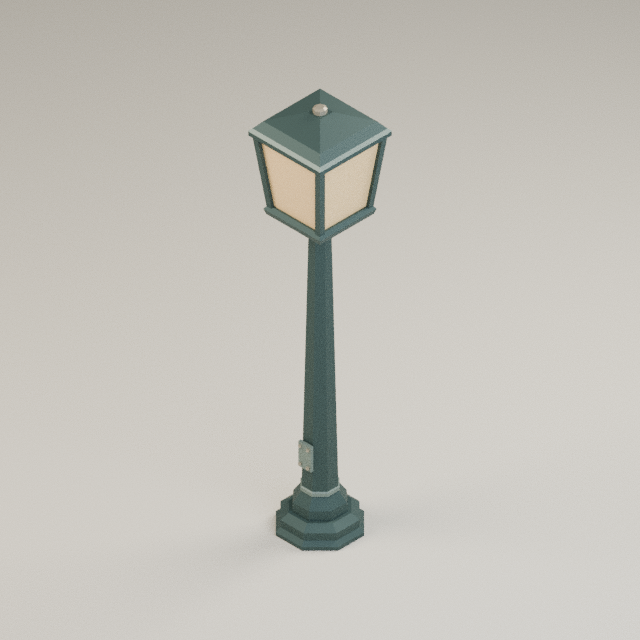

# ART-001 executed verification — 2026-10-21

**Passed:** 39 unit tests; three actual headless Blender builds; independent bundle
validation; byte-identical GLB/front/isometric output in two fresh processes; changed
seed changes actual geometry; exported +Z service-plate and identity-origin checks.

Reference: Blender **4.5.14 LTS**, build `62c1db4208e8`, bundled Python 3.11.15,
host Python 3.14.6, Windows 11, CPU Cycles, one thread, 32 samples, 640×640.
The official portable archive SHA was verified before execution. AMD RX 9070 XT
and integrated Radeon were detected; GPU rendering was not used or tested.

## Actual commands

```powershell
python -m art_pipeline audit --blender C:\Users\rcalm\tools\blender\blender-4.5.14-windows-x64\blender.exe
python -m art_pipeline build --blender C:\Users\rcalm\tools\blender\blender-4.5.14-windows-x64\blender.exe --config configs/streetlamp.json --output build/run-a
python -m art_pipeline build --blender C:\Users\rcalm\tools\blender\blender-4.5.14-windows-x64\blender.exe --config configs/streetlamp.json --output build/run-b
python -m art_pipeline compare build/run-a build/run-b
python -m art_pipeline validate build/run-b
python -c "import json,pathlib; c=json.loads(pathlib.Path('configs/streetlamp.json').read_text()); c['seed']+=1; pathlib.Path('build/seed-variant.json').write_text(json.dumps(c))"
python -m art_pipeline build --blender C:\Users\rcalm\tools\blender\blender-4.5.14-windows-x64\blender.exe --config build/seed-variant.json --output build/run-seed
python scripts/verify_seed.py build/run-a build/run-seed
python scripts/record_art001_evidence.py
```

Every command exited 0. The evidence-recording command actually reran the unit,
comparison, validation and seed/orientation checks; see `commands.json` and their
recorded output files. Fresh runs must choose new output directories.

## Exported measurements

| Measurement | Seed 1701 | Seed 1702 |
|---|---:|---:|
| Triangles | 520 | 520 |
| Export vertices (flat-normal/material splits) | 992 | 990 |
| GLB bytes | 30,460 | 30,412 |
| Materials | 4 | 4 |
| Dimensions X,Y,Z (m) | 0.64, 3.2, 0.64 | 0.64, 3.2, 0.64 |
| Bottom-center pivot error | 0 | 0 |

Seed 1701 GLB SHA256: `8a540b1482b59a83a49187744e3a4da3d84348f291b9a9c5dfd439620e0c3642`.
Seed 1702 GLB SHA256: `3be6b9999fd61df167cc8670261c10e25eccb1cea405efcecc87b468253dd7ab`.
Both same-seed previews also matched byte for byte. Blender reported zero nonmanifold
edges, loose vertices, degenerates, nonfinite vertices and duplicate faces.

The first manifest honestly records a dirty tree from `.gitignore` line-ending
normalization. The second records clean commit `e6e6d06427126058e86b12d095e4440b17a13307`.
Both runs have the same generator source digest; all manifests preserve their actual
source metadata. Source/configs and the complete commands are versioned.

## Actual renders and limits

| Front | True isometric |
|---|---|
|  |  |

Both previews were visually inspected: the framed amber lantern, tapered shaft,
stepped base and front service plate read clearly, without clipped framing. Visible
32-sample noise and opaque amber panes remain; this is a pipeline benchmark, not
production visual approval. Components are closed intersecting shells, not a unioned
watertight printable solid. No textures, imported geometry or asset packs were used.

The `*.manifest.json` files are evidence records, **not complete bundles**. The GLBs
and Blender logs remain under ignored `build/`; the CI workflow uploads complete
versioned bundles as artifacts. CPU/OS/Blender scope is explicit: cross-platform
pixel identity is not promised. Unity import, colliders, LODs, rigging and production
visual acceptance have not been tested here. Contracts remain provisional.
