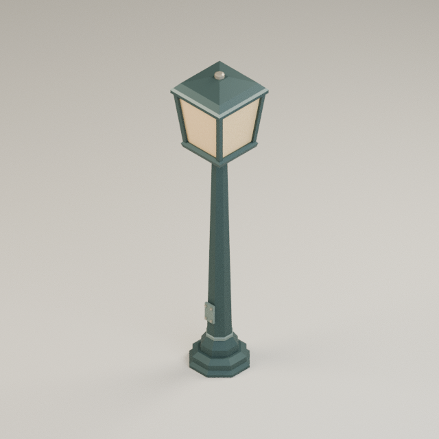
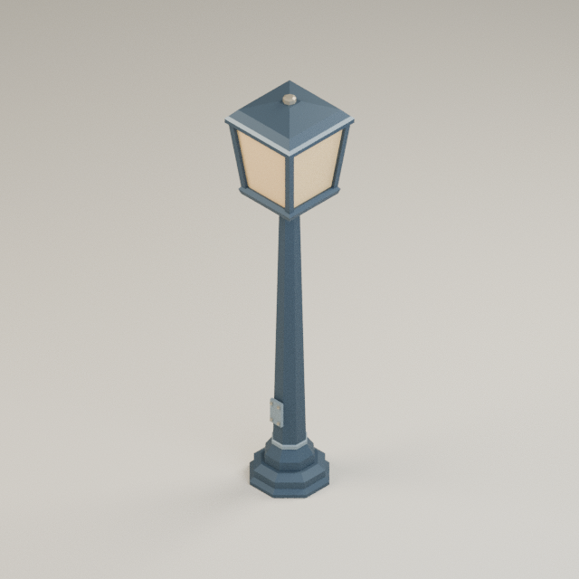
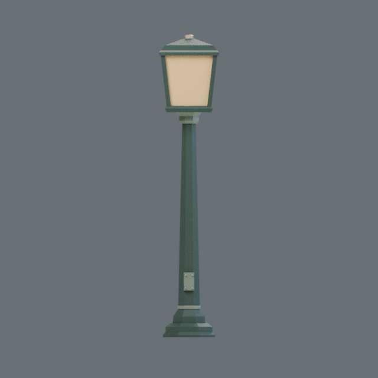
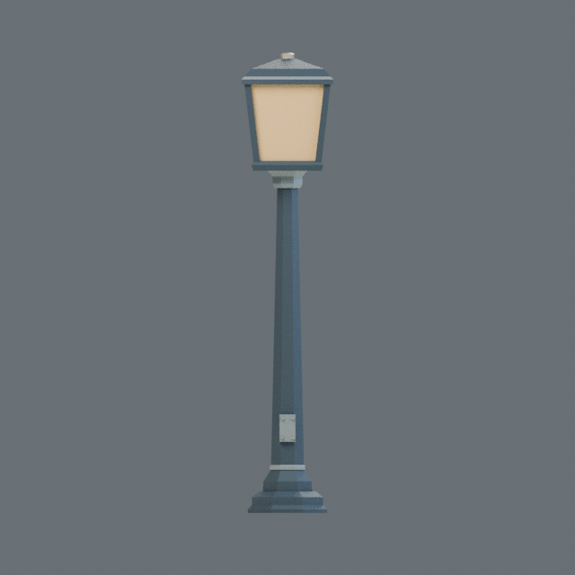

# ART-002 executed comparison — 2026-10-21

Two original palette proposals were actually generated, rendered and independently
validated after ART-001 passed. **52 unit tests passed.** The comparison rechecked
decoded positions, normals and triangle indices; both variants have the identical
geometry digest `0c4435b5e914e12a2c9a293670dda4231b78981c9d764e511491dcc29bf2f26b`.
Equal triangle counts alone were not used to establish a fair comparison.

Source: clean commit `ccf686667c21d4002eefd771e26c078e1141a15a`.
Blender 4.5.14 LTS (`62c1db4208e8`), CPU Cycles, one thread, 64 samples, 640×640,
AgX, denoising off, seed 1701. Camera and lighting are defined in the
[visual bible](../../docs/ART_DIRECTION.md). Only base colors and distinct variant
asset IDs differ; roughness, metallic values and all geometry/render controls match.

## Actual commands and output

```powershell
python -m unittest discover -s tests -v
python scripts/render_benchmark.py --blender C:\Users\rcalm\tools\blender\blender-4.5.14-windows-x64\blender.exe --output build/art-002
python scripts/record_art002_evidence.py
python scripts/package_bundle.py build/art-002/civic_sage --output build/artifacts/prop_streetlamp_benchmark_civic_sage-0.1.0-ccf6866-windows.zip
python scripts/package_bundle.py build/art-002/harbor_slate --output build/artifacts/prop_streetlamp_benchmark_harbor_slate-0.1.0-ccf6866-windows.zip
```

All exited 0. `render_benchmark.py` actually launches one fresh Blender process per
variant, validates both complete bundles and compares their decoded geometry.
`record_art002_evidence.py` independently repeated validation and comparison before
copying the records here. `unit-tests.txt` contains the actual 52-test output.
The full bundles and logs are in ignored `build/art-002/`; the `*.record.json`
files here preserve those runs' original metadata and paths, and are not standalone
bundles. CI is configured to upload versioned complete assets; no Linux run is
claimed by this local evidence.

| Export measurement | civic_sage | harbor_slate |
|---|---:|---:|
| Triangles / budget | 520 / 2,400 | 520 / 2,400 |
| Export vertices | 992 | 992 |
| GLB bytes | 30,476 | 30,480 |
| Material slots | 4 | 4 |
| Dimensions X,Y,Z (m) | 0.64, 3.20, 0.64 | 0.64, 3.20, 0.64 |
| Bottom-center error | 0 | 0 |

All Blender mesh-health counters are zero. The actual models have identity mesh
transforms, and the service plate is on exported +Z. Source geometry/materials
are entirely scripted, with no prebuilt meshes, packs, imported textures or HDRIs.
The [comparison record](comparison.record.json) records model/PNG hashes, input
hashes, exact bounds and tool versions. [Validation output](validation.json)
recomputes the delivered geometry rather than trusting those records.

## Actual rendered comparison

| civic_sage — preferred proposal | harbor_slate — alternate |
|---|---|
|  |  |
|  |  |

160-pixel frame display proxies for the human distance-readability checkpoint
(the same actual renders, displayed smaller; these are not game-camera captures):

| civic_sage | harbor_slate |
|---|---|
|  |  |

## Recorded observations and approval boundary

The agent visually inspected the four full-size actual renders. These observations
are review inputs and **do not constitute human visual approval**.

| Rubric item | Result | Specific observation |
|---|---|---|
| Provenance / technical integrity | Pass | Actual GLB/PNG checks, bounds, materials, hashes and source metadata passed for both |
| Comparative fairness | Pass | Exact decoded geometry digest and shared controls match; base-color changes are isolated |
| Full-size silhouette | Pass | Stepped base, tapered post and framed lantern remain separate in front and true-isometric views; no cropping |
| Material response / value | Pass for benchmark | Sage reads muted green; slate reads cooler blue-gray; common amber panes are the brightest focal mass; trim remains subordinate |
| Surface quality | Revise before production | Residual 64-sample noise and opaque panes remain; no visible holes/inverted faces in these views; intersecting closed construction shells are disclosed |
| 160-pixel readability | Human review pending | Display proxies supplied above; no actual gameplay camera or measured screen coverage tested |
| Town coherence | Not evaluated | Warm architecture/vegetation colors are proposed; a rendered house/tree scene is not delivered here |
| Adult-scale plausibility | Partly evaluated | Numeric 3.20 m height is enforced; no 1.75 m character reference scene or rig has been generated |
| Unity / runtime behavior | Not evaluated | No Unity import, runtime light, collision, LOD or game-camera test |

`civic_sage` remains the proposed baseline. A human reviewer must record the chosen
palette or revisions, the evidence/config revision, rubric observations and approval
before scaling ART-003 production. No production asset set or release is approved
by these successful technical checks. The cross-repository contract remains
provisional, including confirmation of the house example's dimension order.
