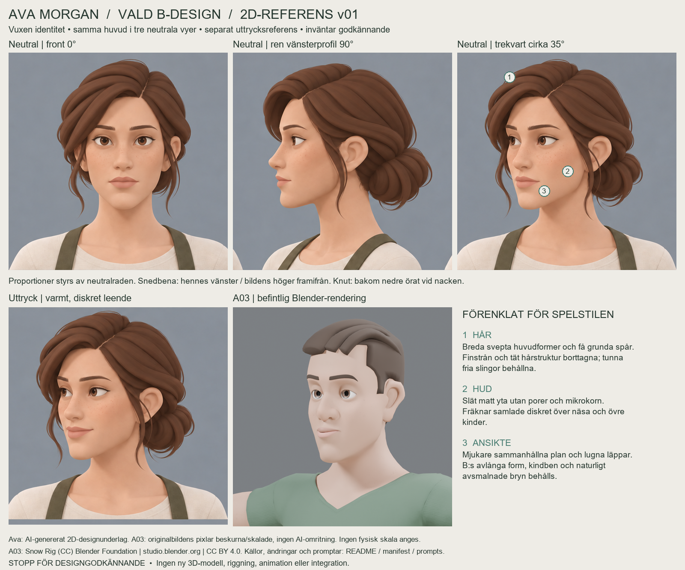

# Ava Morgan — vald B-design, huvudark v01

**B är ägarens officiella visuella riktning. Detta designark inväntar godkännande.** A är inte valt, men inte kvalitetsunderkänt. 2D-designunderlag, inte bevis på en ny 3D-modell.

[Neutrala vyer utan markeringar](ava-b-neutral-views.png) · [Diskret trekvartsleende](ava-b-warm-smile.png) · [Nivåguider](ava-b-proportion-guide.png).

**Formlås:** avlång vuxen ansiktsform, markerade kindben, stödd käke/rundad haka, smala bruna mandelögon, rak näsrygg, naturligt avsmalnade bryn och lugnt munparti. Diskreta fräknar över näsrygg/övre kinder. Snedbenan sitter på **hennes vänster**, alltså bildens höger i front. Håret sveper mot hennes höger; lös låg knut bakom nedre örat vid övre nacken, med tunna ansiktsramande slingor. Neutralraden styr proportionerna; leendet visar en försiktig mungipe-/kindhöjning.

**Sammanhängande underlag:** alla fyra levererade vyer kommer från samma samordnade genererade ark och en riktad hårkorrigering, inte separata porträttbeställningar. Första utkastets extra leendeprofil hade en avvikande nederkant på knuten. Håret förenklades och sluturvalet begränsades till de tre neutrala modelleringsvyerna plus det granskade trekvartsleendet. De dubbla leendevyerna framifrån/i profil är inte levererade referenser. Inga ansikten har förvrängts eller målats om med Python.

**Visuell kontroll:** neutralradens ungefärliga pixelnivåer är hårfäste 105–110, bryn 175–178, ögon 205–208, näsbas 272–277, munsöm 301–304, haka 362–367; öronens nederkant cirka 279–282. Ren profil visar ett öga/bryn utan bortre öga. Sidbena, öroninfästning, kind-/käkform och näslängd läser konsekvent. Trekvartsleendet behåller hårfäste, knut och huvudform. Oberoende bildgranskning fann ingen kvarstående tydlig proportionskonflikt i de fyra valda vyerna. Guiderna visar avlästa nivåband, inte exakt 3D-ortografi eller millimetermått.

**Mot A03, markerat i bilden:** (1) täta hårstrån ersatta av breda mjuka huvudformer och få grunda spår; (2) porer/mikrokorn borttagna, matt hud och återhållna fräknar; (3) mjukare sammanhängande ansiktsplan och lugnare läppkontrast. B:s naturliga bryn behålls. A03:s breda grafiska bryn kopieras inte. Hårets grunda spår är ytsignaler; silhuett, flöde, knut och valda tunna slingor styr en framtida modell.

**Kort självkritik:** identiteten är vuxnare och tydligare än underkända v0.2. Arket har mjukare kindplan än ursprungliga B; en framtida översättning får inte runda eller korta underansiktet ytterligare. A03 är ett faktiskt färdigt 3D-resultat, Ava fortfarande en 2D-design. Profilens djup är nu en designbestämning för ägarens granskning, inte återvunnen Rain-geometri. En senare godkänd Rain-bearbetning kräver verklig samordnad meshformning av mellanansikte, käke/haka, ögonlock, näsa och hår; fungerande hals-/axel-/bröstanatomi ska bevaras.

**Proveniens:** inbyggda `image_gen`; [exakta promptar](prompts.json), [urvalets beskärningar](extraction.json), [SHA256 och A03-källa](manifest.json). Modell-ID/seed exponeras inte; bildgenereringen är inte pixelreproducerbar. Layouten kan upprepas med `python scripts/compose_ava_b_sheet.py` från sparade PNG:er (Python/Pillow, Arial). Den beskär/skalar/placerar och lägger till etiketter/guider; ingen porträttretusch. Inga Blender-/Unity-körningar eller tekniska modelltester gjordes i detta steg.

A03-källa: `male-neutral-a03-v0.3`, `delivery-003/renders/face_three_quarter.png`; byteidentisk källkopia i [A/B-mappen](../ava-design-ab/a03-style-reference.png). Jämförelsen använder en likformig skalning/beskärning för liknande huvudstorlek på bild, inte fysisk skala. **Snow Rig (CC) Blender Foundation | studio.blender.org**, [Snow v4](https://studio.blender.org/characters/snow/v4/), [CC BY 4.0](https://creativecommons.org/licenses/by/4.0/). A03-modell/release är oförändrade. Ava-bilder: AI-design för life-sim-art, med valt B som identitetsreferens och A03 enbart som stilreferens. Ingen Rain-mesh eller extern foto-/meshreferens matades in.

**Stopp för ägarens designgodkännande.** Ingen ny modell, meshbearbetning, riggning, animation, Unity-/GAME-049-integration, merge eller ändring i life-sim-game. PR #42 förblir draft. Rain v0.2 är fortsatt NO-GO (31 290 trianglar); kontraktets gräns är 30 000.
