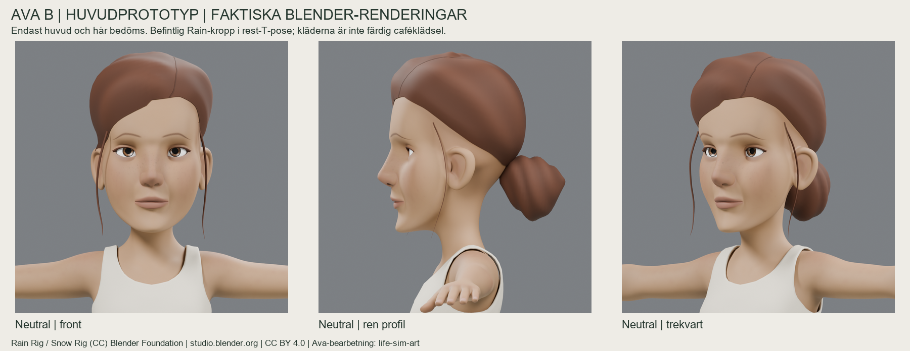
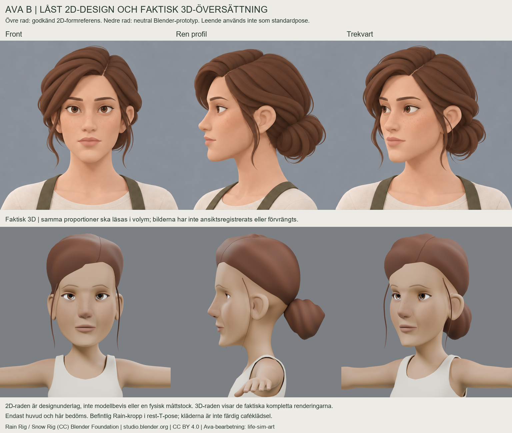
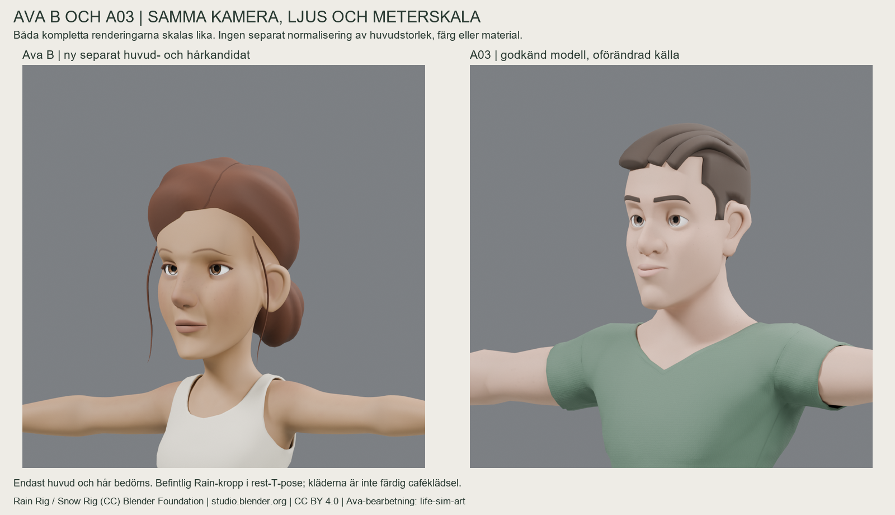
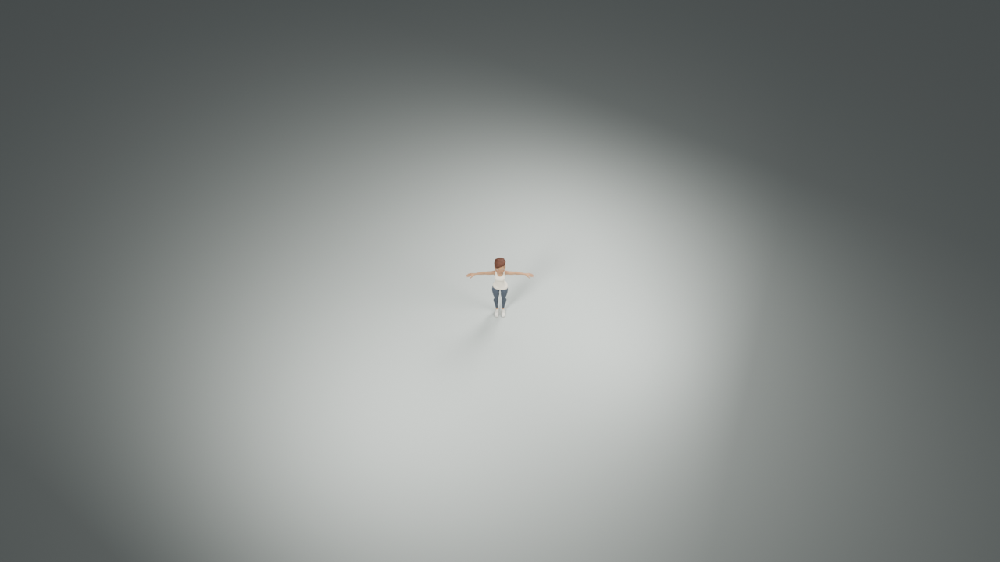

# Ava B — separat Rain-huvudprototyp v0.1

**Slutligt visuellt NO-GO från ägaren 2026-10-31.** Fel ansiktsvolymer mot B, trötta/stela ögonlock, fel profilövergångar mellan näsa/mun/haka, sammanhängande hårmassa och otillräcklig identitet. Ingen ny iteration av detta huvud. Modellproduktion är pausad; [nytt metodbeslut](../../docs/characters/ava-morgan/AVA_B_METHOD_REVIEW.md). Bilder, Blender-källa och ZIP nedan är oförändrad historik. [Godkänt och låst B-ark](../ava-b-design-sheet-v01/README.md) och A03 påverkas inte. Den ursprungliga leveransbeskrivningen nedan är inte ett aktuellt GO.

**Formöverföring:** ny neutral extraktion direkt från verifierat Rain-original, Smile=0. Rains 6 395 huvudpunkter/topologi behålls. En sammanhängande formbur förlänger mellan-/underansiktet: kontrollstationer för ögon +24 mm, näsbas +14 mm och haka −10 mm. Kindben/käke/haka formas i volym, näsryggen får en rakare djupprofil, läpphöjd/projektion lugnas och ögonhåla/glob/lock omformas tillsammans till mandelform. Ett lokalt utjämningspass mildrar kind–munövergångar. Nya avsmalnade bryn följer den faktiska pannytan. Nytt hår formas på Rains skalpyta med vänsterbena, låg sammanhängande knut och tunna slingor.

Kroppens och halsövergångens ursprungliga kontrollpunkter är oförändrade. En sammanfogad hudkopia för visning sluter Rains cirka 13 µm källskarv med 20 µm svetstolerans; inga ansiktsbilder är retuscherade. Originala edit-meshar finns kvar i Blender-filen. Kropp/linne/jeans/skor är ofärdig, oförändrad Rain-kontext i rest/T-pose. Inga färdiga cafékläder eller handdetaljer har producerats.

**Självkritik:** vuxen ansiktslängd, käkstöd, ögonfärg och neutral min följer B:s riktning. Kind–käkplanen är fortfarande kantigare, ögonlocken tyngre och munplanet stelare än referensen. Formburen har överfört de stora landmärkena bättre än samspelet mellan de lokala ögon-/näs-/munplanen. Håret är huvudavvikelsen: skalpföljande formning har gett för sammanhängande massa, otillräckligt svep/lösa lager och en grovare knut. **A03-nivå eller en färdig trogen B-översättning påstås inte.** Vid normal kamera (16 m, 50°, vertikal FOV 40°) syns främst hårfärg/siluett; ansiktsdetaljer kan inte bedömas på det avståndet.

**Budget:** prototypens huvud/hår har 21 822 bastrianglar; huvudytans visningssubdivision ger 59 728 trianglar i den separata huvud-GLB:n. Den är en högre upplöst granskningsfil, ingen slutlig spelmodell. Plan: behåll ansiktets 12 634 bastrianglar, cirka 1 200 ögon, 220 bryn, 144 fransar och 2 400 hår = cirka **16 600**; reservera **13 000 för återstående kropp/kläder**, totalt cirka **29 600 / gräns 30 000**. I detta steg har ansiktet inte decimerats. Senare förenkling av ögonglober/hår och dold kropp kräver ett nytt visuellt GO; budgeten är en plan, inte ett passerat slutkontrakt. Den råa Rain-kontexten på 48 291 trianglar är separat och inte slutlig klädproduktion.

**Källa/licens:** faktisk native SHA256 `831ab6d837c679040285862b15dc9ee5180b018442a88aeaf92aaa7509b80258`; [verifierad licens från den faktiska filens ReadMe](../../docs/characters/ava-morgan/RAIN_SOURCE_LICENSE.md). **Rain Rig (CC) Blender Foundation | studio.blender.org**, [Rain v3](https://studio.blender.org/characters/rain/v3/), [CC BY 4.0](https://creativecommons.org/licenses/by/4.0/); Ava-bearbetning av life-sim-art enligt formändringarna ovan. Ursprunglig ZIP/native är separat bevarade; inbäddad källkod exekveras eller levereras inte. A03 enbart jämförelse: **Snow Rig (CC) Blender Foundation | studio.blender.org**, [Snow v4](https://studio.blender.org/characters/snow/v4/), samma licens. Dess pinnade `.blend`-hash `dcd7681255f49fa704844492b0ffc6964e434ccb4ae59aaba7788b0af56ffd90` är oförändrad. A03 återges på samma plats, i samma studioljus och meterskala, med gemensam kamera; ingen normalisering av huvudstorlek.

**Faktiskt kört:** Blender 4.5.14 LTS, Cycles CPU/48 samples/AgX; Python/Pillow-komposition, filhashar och kontroller av bevarade källor, geometri och statisk GLB utan skins/animationer. Endast två bildtexturer används: hud 2048², ögon 512²; håret använder breda vertexfärgvärden. GPU-rendering, pixelidentisk omgenerering över plattformar och Unity-import är inte testade. [Kommandon](REPRODUCE.md), [bildmanifest](manifest.json) och [paketpost](bundle.json). Blender-källan är huvudunderlaget; GLB:n är uttryckligen endast huvudgranskning.

**Stopp här.** Ingen riggning, animation, Unity-/GAME-049-integration, merge eller ändring i life-sim-game/A03. PR #42 förblir draft. Tidigare underkända kandidater ligger åtskilda som historik.
