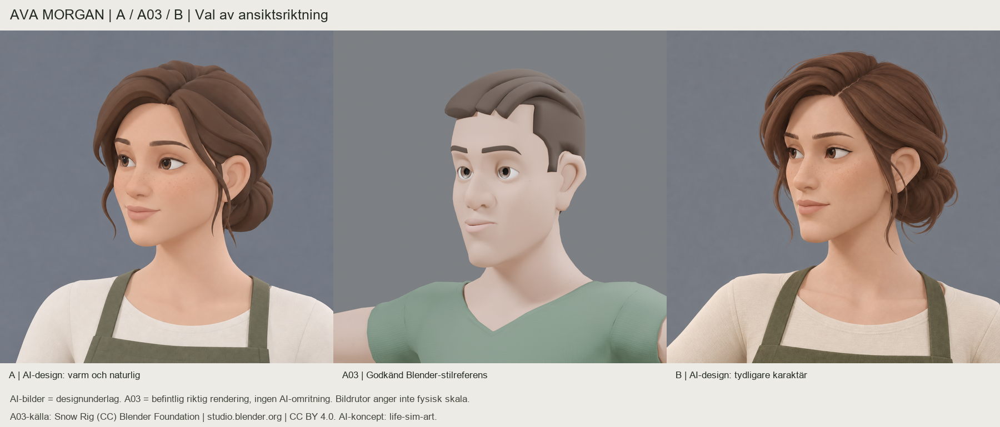

# Ava Morgan — val av ansiktsriktning A/B

**Designfas, inväntar ägarens val.** A och B är AI-genererade 2D-koncept, inte modellbevis. A03 i mitten är en oförändrad befintlig Blender-rendering av den godkända karaktären. Inga nya 3D-modeller eller Blender-körningar har gjorts. Inget fullständigt turnaround-ark är framtaget.

| Alternativ | Visuell riktning | Vad ett senare Rain-arbete skulle kräva |
|---|---|---|
| **[A — varm och naturlig](ava-a-natural.png)** | Mjuk oval, mildare kindplan, mjuka mandelögon, lätt rundad näsa och lös låg knut. Det mjukare och yngre av de två vuxna uttrycken. | Forma Rains ansiktsoval, kinder/käke/haka och ögonlock som en sammanhängande volym. Anpassa nästipp och munprojektion. Modellera hårfästets uppsamling, låg knut och ett fåtal tunna avsmalnande slingor. Bryn behöver mjukare form/texturkant. |
| **[B — karaktärsfull och självsäker](ava-b-confident.png)** | Längre ansikte, tydligare kindben, smalare ögon, rakare näsrygg och markerad snedbena. Tydligare vuxen profil och mer definierad käke. | Större verklig omformning av Rains mellanansikte, kind-/käkplan, näsrygg och ögonparti; inte ett färgbyte eller ett generellt skalreglage. Modellera sidbena, scalp/gather och knutens flöde. Dess finare hårdetalj måste förenklas till A03:s detaljnivå med utvalda meshslingor och ytstruktur. |

I båda fallen bevaras Rain-kroppens fungerande hals-, axel- och bröstanatomi. Ansikte och hår kräver riktig meshbearbetning efter ett separat produktions-GO. AI-bilden blir en designreferens, inte en automatisk bild-till-mesh-leverans. A ligger närmare A03:s förenklade ytor; B visar mer finstruktur i hud/hår, vilket syns i jämförelsen. Ingen geometrisk konsistens mellan andra vinklar är ännu prövad.

**Verktyg/proveniens:** inbyggda `image_gen`, ett grundförslag och en riktad proportionkorrigering per alternativ. Slutbilderna är sparade i denna mapp. [Exakta promptar](prompts.json) och [filhashar](manifest.json) finns intill. Modell-ID och seed exponeras inte av verktyget; pixelidentisk omgenerering utlovas inte. Jämförelsen skalar/placerar bara bilderna och lägger till etiketter; ingen A03-omritning eller porträttretusch. Dess A03-kopia är byteidentisk med käll-PNG:n. Bildrutor anger inte fysisk skala.

A03-referens: `male-neutral-a03-v0.3`, `delivery-003/renders/face_three_quarter.png`. Snow Rig (CC) Blender Foundation | studio.blender.org — [Snow v4](https://studio.blender.org/characters/snow/v4/), [CC BY 4.0](https://creativecommons.org/licenses/by/4.0/). Endast A03-renderingen och respektive AI-utkast matades in som bildreferenser; inga andra foton eller 3D-meshar matades in. AI-koncept skapade för life-sim-art.

**Stopp för val av A eller B.** Ingen extern artist har anlitats. 3D-produktion, riggning, animation, integration, merge och life-sim-game-ändringar är fortsatt pausade/förbjudna. v0.2 är fortsatt NO-GO och kontraktsgränsen för en framtida 3D-leverans är fortfarande 30 000 trianglar. Ett designval är inget rigg- eller produktionsgodkännande.
