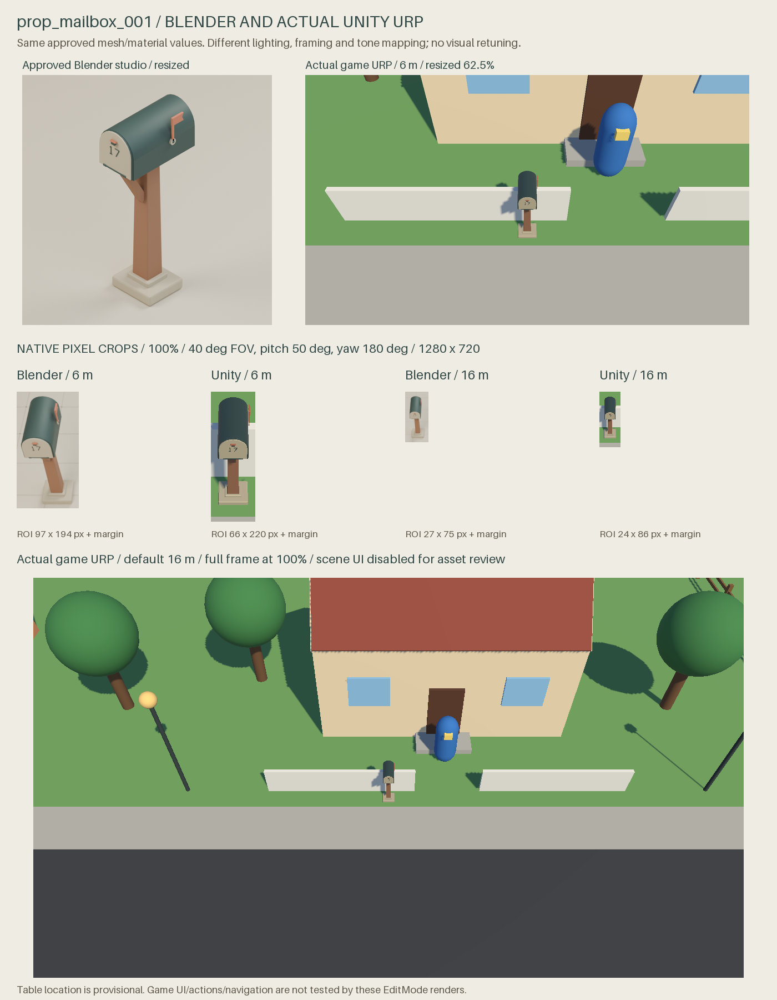
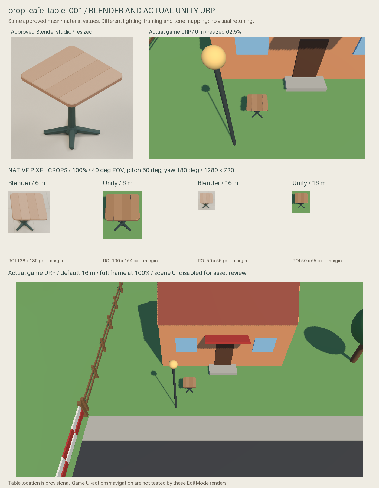

# First Playable Day: actual Unity URP validation

2026-10-25. **Local graphics/import validation passed. Game import-contract
acceptance and merge remain pending.** The owner visually approved both props.
No mesh, material value or approved Blender image changed.

Claude currently has no credits. PR34 is the reviewable handoff; an unanswered
request in [game53](https://github.com/bobo91/life-sim-game/issues/53) is not
acceptance. [Claude checklist](../../docs/props/CLAUDE_IMPORT_HANDOFF.md) and
[FPD-PROPS-IMPORT-1](../../docs/props/first-playable-unity-import-proposal.json).





## What actually ran

Unity **6000.5.8f1**, **Direct3D11**, official **glTFast6.20.0**, **URP17.5.0**,
Linear color. A fresh art-workspace copy of committed game branch
`9a85db5cb69ccf01ae584f42c9237703be4e2327` was opened in EditMode. No PlayMode,
game source/package change, bootstrap regeneration, save-service call, player
build or integration. Private source archive stays local; SHA256
`001063dba9be7403067354596460cf60c6837fdfa24fa3acecb3212f66d4ebf3`.

| Attempt | Actual result | Time | Visual finding |
| --- | --- | ---: | --- |
| [003](graphics-003/attempt.json) | Exit0, graphics/import passed | 59.964s | Serialized EditMode UI obscures props with a fixed black/purple rectangle; [original capture retained](graphics-003/prop_mailbox_001_game6m.png). |
| [004](graphics-004/attempt.json) | Exit0, graphics/import passed | 44.431s | Sole targeted correction disables three Canvas components in the isolated scene. Rectangle absent; no retouching. |

Two graphics launches; no further iteration. Earlier restricted launch001 and
Null-graphics diagnostic002 retain their failures in the
[historical report](HISTORICAL_IMPORT_001_002.md).

[Final report004](graphics-004/unity-game-lighting-report.json), SHA256
`86dd346528720882b96e6ee9a72dba21540feba38f4c97339b3fd91feab0fb6b`.
The host adds only original-file integrity fields after Unity exits. Error
arrays are empty. Raw host/licensing logs and private game project are not
published. [Report003](graphics-003/unity-game-lighting-report.json) and its
[exact checker](graphics-003/checker-source.cs) are preserved.

## Verified results and limits

| Asset | Measured XYZ (m, rounded) | Triangles | Meshes / material slots |
| --- | --- | ---: | ---: |
| prop_mailbox_001 | .36 / 1.43 / .62 | 2,324 | 1 / 4 |
| prop_cafe_table_001 | .78 / .74 / .78 | 856 | 1 / 4 |

- Actual GLTFast.Editor.GltfImporter import. Unit scale, bottom-center pivot,
  finite positions/normals, valid indices, counts and dimensions pass. Mailbox
  +Z landmark passes; the symmetric table has no unique semantic-front landmark.
- All eight names/base colors/metallic/roughness values match the unchanged
  GLBs, including glTFast's expected color-factor gamma conversion. Shaders
  are supported, declare UniversalPipeline, and have no reported shader error.
  Selected tags also now read UniversalPipeline, unlike diagnostic002.
- Actual UniversalRenderPipeline render requests produced six nonempty PNGs
  without error-magenta pixels. Renderer-on/off comparisons verify prop pixels
  in projected bounds. Root visually inspected final sheets/source captures.
- New validation scene saved/reopened; geometry/material/transform/collider
  checks repeated successfully. Original Bootstrap bytes and every original,
  staged and imported GLB retain their hashes.
- Candidate root BoxColliders contain meshes and pass front/top raycasts:
  mailbox center(0,.715,0), size(.36,1.43,.62); table center(0,.37,0),
  size(.78,.74,.78). **Tested proposals, not game-approved collisions.**
  Table box blocks its full footprint. Routes, seating and final anchor untested.

Mailbox uses its existing anchor. Table has no accepted anchor in this snapshot;
its cafe-side site is provisional. First two raw images use the serialized
start camera. Prop views use game FOV40/pitch50/yaw180, focus1m, distance6/16m.
These are offscreen Editor renders, not a running standalone player or UI test.
The mailbox needs an action prompt independent of its decorative flag. Claude
must reconcile action2.2m/marker5m with issue51's prompt-from5m criterion.

## Blender versus Unity

Blender Cycles uses AgX and three large studio area lights. Actual game settings
are preserved: warm directional Sun1.2, color1/.94/.82, Euler50/150/0; default
skybox ambient/reflections1; HDR camera, postprocessing off, no fog or active
tonemapping pass. URP soft-shadow support is off, MSAA1. Only UI is disabled.

Unity looks darker/flatter with harder shadow edges and more pixel aliasing.
Sage metal, timber, cream trim and silhouettes remain distinguishable. No
missing surfaces, floating parts or erroneous material blocks appear in final
images. At16m flag/number and plank seams have limited pixels. No aesthetic
change is proposed; the explicit mailbox prompt remains necessary.

Native crops share camera settings but not identical composition: Blender
frames two props side by side/off-axis; Unity centers each at its game/test
site. Crop extents therefore differ. The hero uses a separate studio camera.
Lower Unity16m frames and crop panels retain100% pixels. No color adjustment,
relighting, repainting or AI enhancement. [Layout/input/model hashes](comparison/comparison-layout.json).

## Tested source and reproduction

[Final checker](../../scripts/PropsGameLightingCheck.cs) SHA256
`fb3a90a4f4548a618d623dfa921abf664c79e73bdc341ee9e49b7446e008a16d`;
[host](../../scripts/run_props_game_lighting_check.py) SHA256
`80637506b4c27d32e5d4415ec590a78a612592e76b96e06547c2d447e9a09c42`.
Host requires fresh directories and no active Unity process, stages only a
pinned committed snapshot and verifies immutable source/model hashes.

```powershell
python scripts/run_props_game_lighting_check.py --snapshot <private-pinned-game-source.zip> --project build/first-playable-props-unity/game-lighting-new --output build/first-playable-props-unity/game-lighting-new-results
python scripts/run_props_game_lighting_check.py --project build/first-playable-props-unity/game-lighting-new --output build/first-playable-props-unity/game-lighting-new-results --editor "<Unity-6000.5.8f1-executable>" --run
python scripts/compose_props_unity_comparison.py --unity build/first-playable-props-unity/game-lighting-004-results --output build/first-playable-props-unity/comparison-new --font default
```

Composition actually ran with portable Pillow embedded font and checked eight
native crop panels byte-for-byte. Original Blender PNGs are unchanged; their
historical embedded "awaiting approval" captions do not override owner approval.
All prop geometry/material provenance remains in original manifests. No
purchased/prebuilt mesh, paid tools or further prop production.

Official importer [Editor docs](https://docs.unity3d.com/Packages/com.unity.cloud.gltfast@6.20/manual/ImportEditor.html),
[registry](https://packages.unity.com/com.unity.cloud.gltfast). Exact Apache-2.0
package license evidence remains in the historical report; Unity/dependency
terms are separate. No license activation, seller contact or purchase.

**Recommendation: local import/render GO; game integration/merge HOLD.**
Explicit #53 confirmation and game runtime checklist remain open. Counter/chair/
tin start after that gate in the approved style, without a new long design study.
No automatic merge. Ava work and draft PR33 stay paused.
