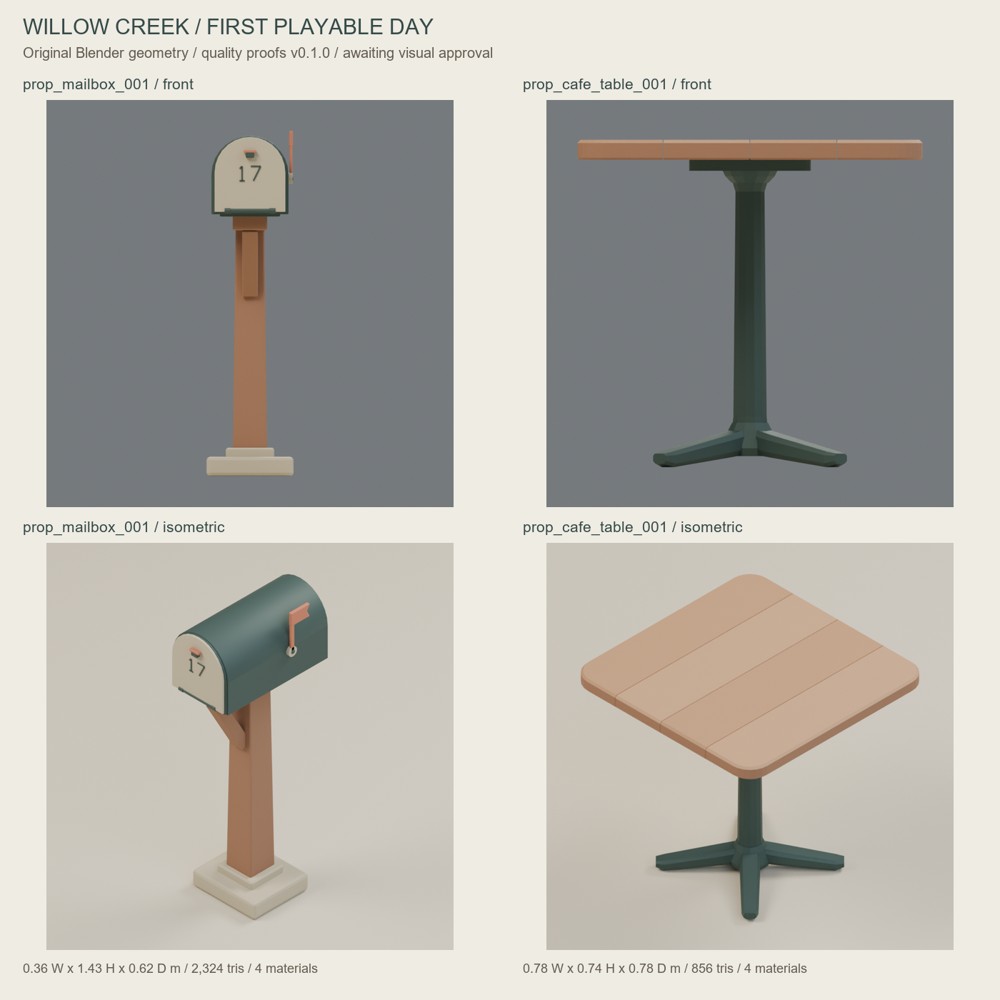
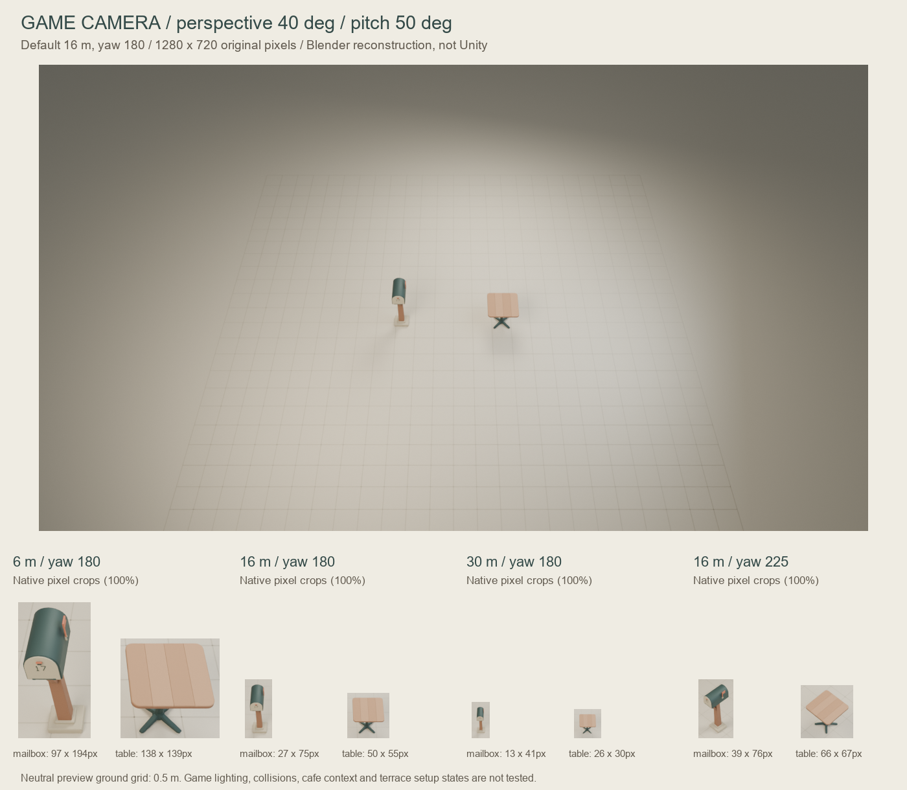

# First Playable Day — mailbox and cafe table quality proofs

2026-10-24. **Ready for owner visual review, not production/game approval.**
Only two props were built. Counter, chair and tin remain a
[five-ID plan](../../docs/props/FIRST_PLAYABLE_PROP_PLAN.md). Ava and PR #33 stay
paused/draft; no seller contact or purchases occurred.





These are actual Blender Cycles CPU renders of final **run-004**, not generated
concept images. Contact sheets use resizing/layout for hero images and **100%
native pixels for game crops**; no repainting or generative enhancement.
[Exact layout and input hashes](comparison-layout.json).

## Delivered proofs

Dimensions are X width / Y height / Z depth, in meters. All are authoring
proposals pending Claude/game confirmation, not canonical collider dimensions.

| ID | Dimensions | Exported triangles | GLB bytes | Slots |
|---|---|---:|---:|---:|
| `prop_mailbox_001` | 0.36 / 1.43 / 0.62 | 2,324 | 142,356 | 4 |
| `prop_cafe_table_001` | 0.78 / 0.74 / 0.78 | 856 | 48,468 | 4 |

Original Python-generated vertices/faces and opaque core PBR materials only.
No imported mesh, texture set, font, HDRI, purchased pack or paid generation.
The mailbox's 17 mark is original geometric strokes. The table has four closed
timber planks, rounded outside corners and a four-foot cast-metal pedestal.

- Mailbox [front](prop_mailbox_001/front.png), [isometric](prop_mailbox_001/isometric.png),
  [manifest](prop_mailbox_001/manifest.json), [mesh/persistence report](prop_mailbox_001/build_report.json).
- Table [front](prop_cafe_table_001/front.png), [isometric](prop_cafe_table_001/isometric.png),
  [manifest](prop_cafe_table_001/manifest.json), [mesh/persistence report](prop_cafe_table_001/build_report.json).
- Full-size [default game-camera frame](game_distance_16m.png) and
  [rotated camera frame](game_distance_16m_yaw225.png).

GLB and editable `.blend` files stay outside ordinary Git blobs. The local
complete bundle is `build/first-playable-props/run-004`; a sanitized copy is
packaged as `build/artifacts/first-playable-props-v0.1.0-review.2.zip`.
The PR workflow reproduces and uploads a separately hashed versioned review
artifact, retained for 30 days. This is not a production release. The
[artifact record](artifact.record.json) records availability and checksums.

## What actually ran

Environment audited before construction: Blender **4.5.14 LTS**, embedded
Python **3.11.15**, system Python **3.14.6**. GPU availability was audited
locally; **all actual renders used CPU**, four threads. No GPU kernel or Unity
test was run. Public copies omit local paths and host hardware/OS details;
raw audit logs remain local. [System](system-environment.json), [Blender](blender-environment.json).

Reproduce from the art PR source tree in this repository:

```powershell
python scripts/run_first_playable_props.py --blender blender --output build/first-playable-props/review-replay
python scripts/compose_first_playable_props.py --input build/first-playable-props/review-replay --output build/first-playable-props/review-sheets
python -m unittest discover -s tests -v
```

The runner requires a new output directory, uses offline/factory startup with
auto-execution disabled, records commands, hashes, seed/config and the dirty
source snapshot, and refuses a source change during a build. Its common
dependency-free GLB validator checks the **actual exported file**. The existing
streetlamp CLI/config validator was not changed or claimed to support these
new prop configs.

Final build **run-004 completed in 98.832 seconds**, including eight renders,
two saves/reopens and two GLB roundtrips. Independent GLB checks passed for
bounds, bottom-center pivot, one identity-transform mesh, units/axes,
triangles, indices, normals/winding and four PBR material slots. Mailbox forward
is additionally tested against an actual front-door vertex in exported +Z;
the symmetric table has no unique semantic front feature.

Both meshes have zero non-manifold edges, loose vertices, degenerate faces,
duplicate faces or nonfinite positions in the performed Blender checks.
Save/reopen preserves exact geometry. GLB export/reimport preserves triangle
counts and unique positions to five decimal places. This does **not** certify
arbitrary solid intersections, collisions, material appearance in Unity or
game integration. The existing core validation suite also ran: **52 tests
passed**, 0.492 seconds; those tests exercise shared pipeline validation, not
an aesthetic acceptance function.

A separate **geometry-only replay** regenerated both final GLBs byte-for-byte
identically after checking all frozen source/config hashes. It took 0.568s in
Blender, used no renders and changed no generator. See
[exact replay command/result](geometry-replay.json) and
[verification script](../../scripts/verify_first_playable_props.py).

## Camera and observed visual result

The camera is reconstructed from game main
`863906b5de720bca72105bfeeb126a5ba7a0af08`, not guessed from an isometric image:
perspective, **40-degree vertical FOV, pitch50, yaw180, focus height1m**, at
**6/16/30m**. Additional yaw225 at16m shows an ordinary orbit view. All game
renders are **1280x720**, matching the evidence-capture code. They use a neutral
half-meter grid, not the cafe scene or Unity's realtime lighting. The camera
parameters are matched; engine shading, actual gameplay placement, UI,
occlusion and player movement are not reproduced.
[Camera/coverage record](game-camera.json), [pinned source review](../../docs/props/FIRST_PLAYABLE_CONTRACT_REVIEW.md).

| Camera distance / yaw | Mailbox projected width x height | Table width x height |
|---|---:|---:|
| 6m / 180 | 97 x 194 px | 138 x 139 px |
| 16m / 180 | 27 x 75 px | 50 x 55 px |
| 30m / 180 | 13 x 41 px | 26 x 30 px |
| 16m / 225 | 39 x 76 px | 66 x 67 px |

Our visual review: both are recognizable at default16m. The mailbox reads as
tunnel box, pale door, post and foot; the table reads as a warm rounded top
over a dark pedestal. Broad material roles remain distinct. At30m address,
hardware and table seams disappear; the main silhouette remains. The flag is
nearly edge-on at the default front yaw and reads better after orbiting. It
must not be the only cue for a letter/gameplay state. Table setup-state
readability still needs the separate chairs/cloth/cups/parasol, absent here.
No owner visual approval is inferred from this review.

## Actual problems and corrections

Four full builds were preserved, not hidden as one attempt:

1. **run-001, 76.512s:** valid exports, but table isometric framing cropped
   its top corners. Mailbox flag showed a dark rectangular artifact at coplanar
   stem/paddle surfaces. Numerical manifold checks did not catch that visual issue.
2. **run-002, 91.146s:** fitted hero framing and added yaw225 camera evidence;
   prop geometry/GLB hashes remained identical to run-001. Cropping was fixed.
3. **run-003, 86.982s:** only the mailbox flag paddle's X surfaces changed
   `.164/.176 -> .162/.178`, enclosing the overlap. Final actual isometric
   inspection shows the dark rectangle gone. Dimensions/materials/triangles
   remain unchanged. Table GLB is byte-identical across all three builds.
4. **run-004, 98.832s:** publication/portability reproduction after replacing
   personal executable defaults with `BLENDER_BIN`/`blender` and measuring the
   actual dirty-source flag. All eight PNGs and both GLBs are byte-identical to
   run-003. No geometry or art parameters changed. The repeated geometry-only
   check also passed. CI is a separate reproduction, not a new art iteration.

The first raw archive (`review.1`) is retained locally and is not uploaded: it
contains private host audit metadata. Public evidence and the `review.2` archive
use explicitly normalized paths and omit that metadata. Source/config and
model/render hashes, geometry measurements and timings are preserved.

Remaining geometry limits: the mailbox has25 and table12 individually closed
construction components; attached parts intentionally meet/overlap. They are
not a single welded/boolean-unioned solid, and no exhaustive inter-component
penetration solver or runtime collider test was performed. No obvious holes,
floating parts or shading defects were observed in the final viewed renders.

## Coordination and next gate

IDs for mailbox/counter/table/chair occur in game #51/#53/#55. The tin ID is
owner-proposed; game #56 currently defines narration/story flags, not a physical
tin/inventory implementation. Dimensions, collider envelopes, anchors and
prefab/state conventions still need agreement. The pinned game tree contains
**no GLB/glTF importer**, despite GLB in the provisional contract. No game
package or code was changed to mask that gap. Static Unity import/material
behavior remains **not tested**.

Recommendation: **GO for owner visual review of these two proofs; hold the
remaining three assets and game integration.** Ask Claude to acknowledge the
IDs/proposed envelopes and choose the GLB import/material path on the game
side. Do not silently replace the contract with FBX. No merge is performed.
