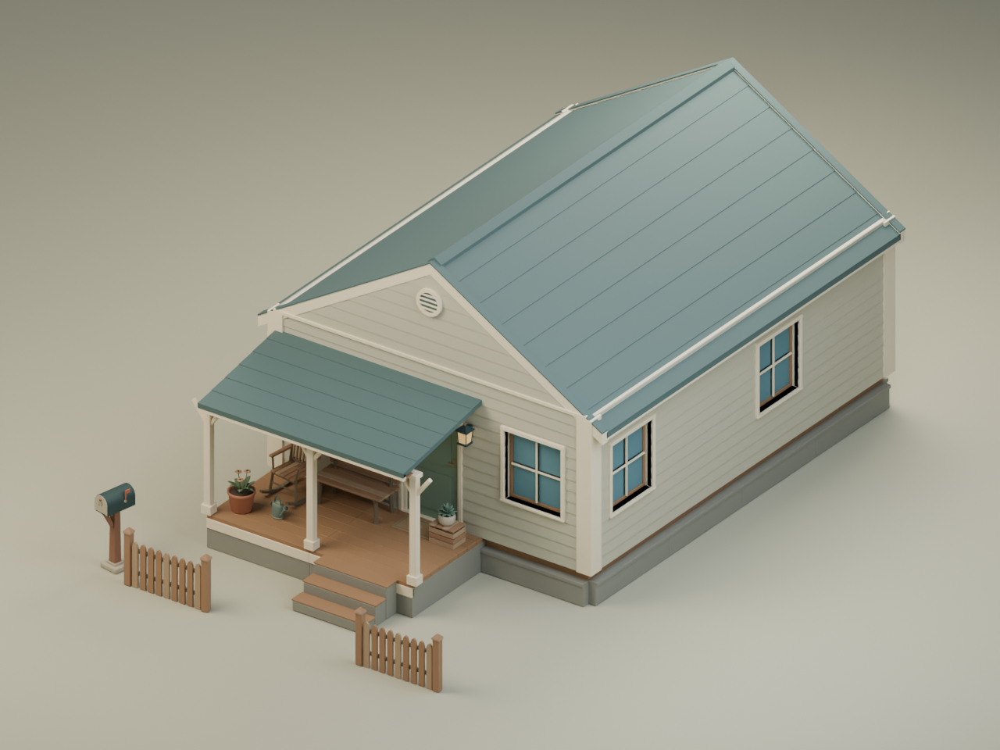

# Walter's House modular prototype — quality report

**Recommendation: GO for owner visual review of this bounded prototype.**
This is not approval for merge or game integration. Sixteen original modules
create Walter's 6 x 8 m house and a smaller 6 x 4 m house, with the same meshes
and configured material variations. Nine shared opaque PBR materials per house.

## Actual images

| View | What it demonstrates |
| --- | --- |
| [16 m game perspective](walter-game-16m.png) | 40-degree vertical FOV, pitch 50, yaw 180; building review anchor, full scene in frame |
| [6 m entry closeup](walter-entry-6m.png) | Lower 15-degree inspection angle to show the door below the canopy; intentional close crop |
| [Roof hidden](walter-roof-hidden.png) | Independent roof/canopy sections; ground-floor shell stays intact |
| [Selected walls hidden](walter-cutaway.png) | South/west walls, their inserts/corners and mounted lantern hide together |
| [Module contact sheet](contact-sheet.png) | Front/isometric renders of all sixteen individually exported modules |
| [Alternative house](alternate-house.png) | Shorter layout, relocated entry/porch and sage palette; zero new module IDs |

These are actual Blender renders. The contact sheet only resizes/layouts those
renders. No generated concept images, repainting or external asset services.
The 16 m view is a documented game-perspective proxy, not a Unity screenshot or
a test of the game's player-follow camera. Entry framing intentionally crops
parts of the complete building. Exact cameras/hashes are in the evidence.

## Verification actually run

- **66 Python tests passed.** The regressions cover GLB validation, authored
  anchors, genuine openings, cladding continuity and collision-box clearance.
- Fresh isolated **Blender 4.5.14 / embedded Python 3.11.15**, offline,
  Cycles CPU / four threads. GPU devices were enumerated; no GPU render claimed.
  Final Windows generation, render and validation took **146.087 seconds**.
- All sixteen meshes passed finite/degenerate/duplicate-face, manifold-edge,
  loose-vertex and positive-volume checks. Independent GLB validation passed
  materials, winding/normals, dimensions and configured anchors within 1 mm.
- All sixteen modules passed save/reopen and GLB position/triangle roundtrip.
  A separate fresh geometry run reproduced **16/16 GLBs byte identically**.
- Both assembled houses passed save/reopen and GLB roundtrip. Their instances
  retain shared module mesh data. Walter: **40,892 triangles**; alternative:
  **27,132 triangles**, excluding presentation props. Unique module inventory:
  **9,852 triangles**. Both houses use nine materials.
- Door/window wall openings passed nine actual Blender ray samples each;
  the door frame passed nine clear-passage samples with the leaf excluded.
  Clear door passage is 0.99 x 2.135 m above a 15 mm threshold.
- All ten porch props and the mailbox match their earlier pinned GLBs
  **byte for byte**. They retain their asset IDs and original source snapshots.
- Packaging verifies source/model/render hashes and reads every ZIP entry back.
  The Linux workflow repeats generation, tests, render composition and packaging;
  its actual status and downloadable artifact are linked in the PR.

[Measured evidence and exact source hashes](technical-results.json).
[Module/import contract and reproduction commands](../../docs/buildings/MODULAR_BUILDING_SYSTEM.md).

## Visual findings and limits

The pale clapboard, cream trim, muted roof and warm deck agree with the existing
porch props. Roof courses join without visible two-metre bay cracks. Windows
align consistently, and the alternative changes the building's proportions
without new geometry. Small trim projections and foundation corner recesses
remain visible construction details.

Actual render review caught and corrected coplanar stair surfaces, foundation
and post cap surfaces, missing partial siding courses, window casing depth,
imported prop rotation handling, and the wall-mounted lantern's cutaway state.
These are why manifold checks alone are insufficient for visual acceptance.

The prototype has a fixed 6 m roof span/pitch, an empty ground floor and an
attic-like silhouette; it has no upper floor, furnished rooms, transparent
glazing, UV/lightmap bake or LOD system. Closed construction solids deliberately
meet/overlap at joints; there is no exhaustive solid-intersection proof.
**Unity import/URP appearance, runtime hiding, navigation and collisions remain
unverified and game-owned.** Collision shapes and entry anchors are proposals.

The branch starts from main. PR #34/#36 source snapshots are included unchanged
for reproducibility; no unmerged branch checkout is required. PR #33/Ava,
PR #34/#35/#36 merge decisions and the game repository are untouched. No purchases,
external generation services or automatic merge.
