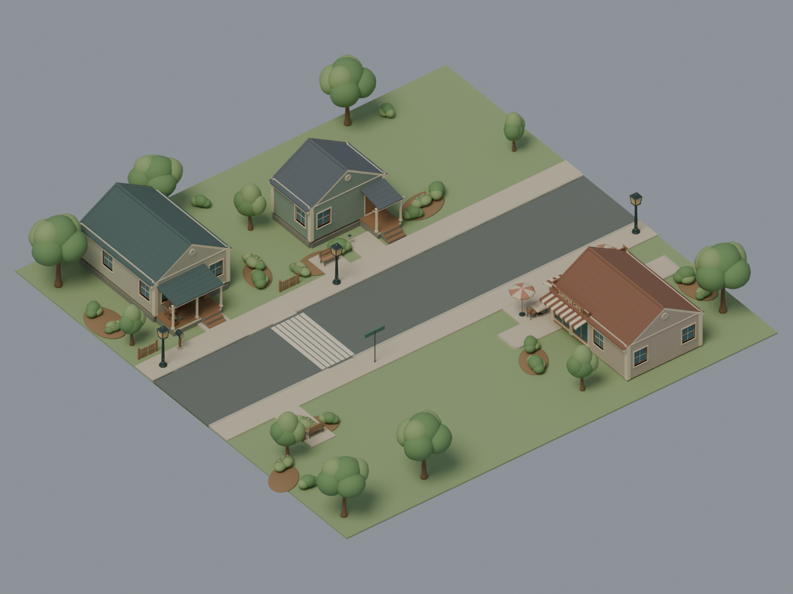

# First Neighborhood Environment — quality review

**Recommendation: ready for owner visual review of the first neighborhood.**
The final 36 x 36 m block joins Walter's house, a smaller neighbor and Juniper
Cafe with one street, continuous sidewalks, curb ramps and a proposed 36 m
walking route. The cafe has tall glazing, wraparound striped awnings, original
lettering and a terrace with both dressed and bare approved tables. Its counter
is placed inside facing the room.

| Actual Blender view | Review purpose |
| --- | --- |
| [Walter from street level](walter-street.png) | House, porch, mailbox, planting and sidewalk scale |
| [Cafe and terrace](cafe-terrace.png) | Commercial identity, entry clearance and existing furniture |
| [Normal camera at 16 m](game-16m.png) | Perspective 40-degree vertical FOV, pitch 50, yaw 180; explicit layout focus |
| [Walter-to-cafe route](walking-route.png) | Proposed walking corridor; gold line is a removable review overlay |
| [All sixteen new assets](contact-sheet.png) | Actual front/isometric renders, measured dimensions and triangle counts |
| [Top-down layout](top-down.png) | Buildings, street and entrance markers; labels are review overlays |

Images are actual renders, with only contact-sheet resizing/layout. The 16 m
view deliberately shows a local slice of the neighborhood. None is a Unity
screenshot or runtime navigation test.

## Measured verification

- **80 Python tests passed**, including unchanged dependency pins, coordinate
  conversion, unique placements, route coverage and rotated/scaled furniture
  clearance. Regressions detect the original table/crate route intrusions.
- **Blender 4.5.14, embedded Python 3.11.15, offline Cycles CPU, four threads.**
  Final Windows generation/render/validation: **160.659 s**. GPU enumeration
  succeeded; no GPU rendering is claimed.
- **16 new assets**, **13,488 unique new triangles**, **21 existing references**.
  Whole scene: **269 root instances / 233,516 instanced triangles**. The derived
  cafe is **42,276 triangles / nine materials**. No runtime performance benchmark.
- New meshes passed manifold/loose/duplicate/degenerate/finite/volume checks,
  independent GLB normals/material/dimension/anchor validation, save/reopen and
  GLB roundtrips. A separate process reproduced **16/16 new GLBs byte identically**.
  The cafe and complete editable scene also passed persistence checks.
- **18 existing prop GLBs match approved bytes exactly.** Both existing houses
  match their approved world-position/triangle fingerprints. The existing main
  streetlamp is regenerated from its pinned original source/config. All reference
  GLB roundtrips passed. No expiring input artifact or unmerged branch checkout
  is required for a fresh build.
- Packaging verifies source/model/render hashes and reads every indexed ZIP
  entry back. Actual Linux CI and downloaded-artifact verification are linked
  in the PR after completion.

[Exact evidence](technical-results.json) ·
[Unity handoff and commands](../../docs/neighborhood/IMPORT_HANDOFF.md) ·
[Reference commits and provenance](../../docs/neighborhood/DEPENDENCY_PINS.md).

## Quality findings and limits

Actual render review corrected overlapping paving/corner surfaces, exposed
curb cap surfaces, preview-floor clipping of the below-anchor awning, hidden
entrance labels and table/crate placements that narrowed the walking corridor.
The tighter block, shared palette, planting beds and corner shopfront make the
three buildings read as one small street. Some back-yard grass remains usable
open space; this is a compact first block rather than a finished town.

Routes are nominal proposals, not exact foot-contact curves. Stairs, ramp
projection, traffic rules, collision layers, actual pedestrian capsules and
NavMesh must be checked in the game. Closed construction parts intentionally
meet/overlap internally; there is no exhaustive solid-intersection proof.
Glazing is opaque; interiors are sparse shells, with only the cafe counter/tin
placement. There is no furnished interior, LOD/lighting bake, wind animation or
runtime interaction/hiding implementation. **Unity importer/handedness, URP
appearance and game lighting remain unverified.**

PR #34–#37 were open/unmerged at the production audit; their immutable source
pins remain unchanged. The new branch starts from main. No purchases, external
generation services, game-repository changes, Ava work or automatic merge.
